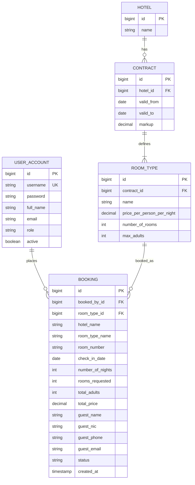

# ER Diagram — Sun Travels

## Conceptual model

## Relationships

| From | To | Cardinality | Meaning |
|------|-----|-------------|---------|
| Hotel | Contract | 1 : N | Same hotel can have contracts for different periods |
| Contract | RoomType | 1 : N | Each contract lists room types/rates/inventory |
| UserAccount | Booking | 1 : N | Agent/manager who created the booking |
| RoomType | Booking | 1 : N | Bookings consume a physical room number under that type |

## Normalization notes

- **Hotel** separate from **Contract** so hotel identity is not duplicated per period (avoids update anomalies if hotel is renamed once).  
- **RoomType** depends on Contract (rates are contract-period specific).  
- **Booking** stores denormalized `hotel_name` / `room_type_name` as a **snapshot** for history if contracts change later (intentional, not 3NF violation for reporting).  
- **Room numbers** are derived as `1..number_of_rooms` (not a separate ROOM table) to match the paper contract “No of rooms” field; bookings store the chosen `room_number`.

## Data volumes (thought through)

| Entity | Expected volume (agency) | Design response |
|--------|--------------------------|-----------------|
| Hotels / contracts | Hundreds–low thousands | Index `contracts(valid_from, valid_to)`, paginated contract list |
| Room types | Few per contract | Loaded with contract (JOIN FETCH on search) |
| Bookings | Tens of thousands / year | Index `(room_type_id, room_number, status)`, overlap queries on dates |
| Concurrent agents | Dozens | Row lock on `room_types` during book |

Seed profile (~50 hotels × 4 types, ~400 bookings) is used to exercise pagination/sort and search latency in demos.
